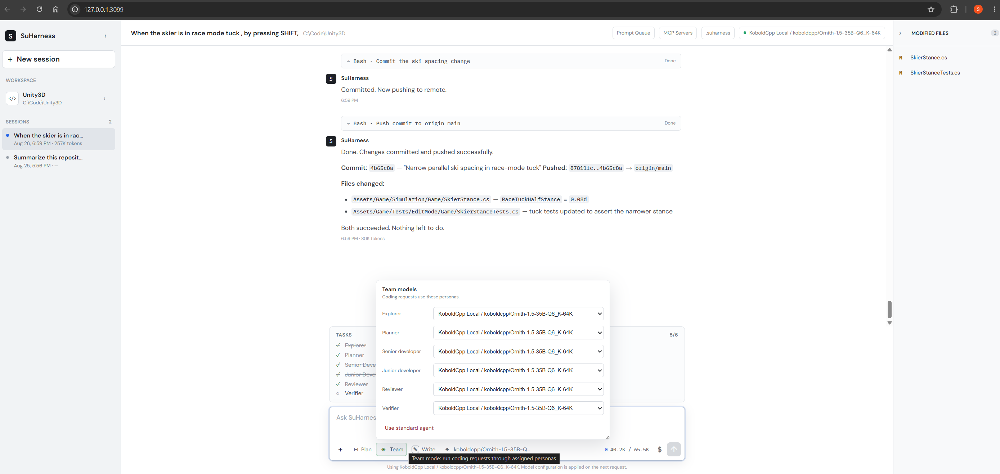

# Large Codebases and Small Local Models

## Why I built SuHarness

**Suhas Rao**

*26 August 2026*

Large codebases are hard. Small local language models make them brutally honest.

Give a powerful frontier model a large repository, a huge context window, and plenty of tokens,
and it can often compensate for an inefficient agent around it. Give a much smaller model the same
job and everything starts to break.

It searches too broadly. It reads too much. It forgets requirements halfway through the task. It
repeats the same tool call. It finds the right file but loses the thread five steps later. Sometimes
it writes perfectly reasonable code for the wrong problem. Sometimes it simply tells you what it
would do and decides that counts as finishing the job.

I kept running into exactly this while experimenting with locally hosted models on real codebases.
That led to the question that became the starting point for SuHarness:

> Can a small language model do genuinely useful work in a large, unfamiliar codebase if the
> system around it carries more of the engineering burden?

That question is more interesting to me than asking which model has the highest coding benchmark
score. Once I started pushing smaller models beyond code completion and into real repository work,
I began to notice something: sometimes the model was not the biggest problem. The harness around
the model was.



*SuHarness completing and pushing a Unity gameplay change with Team mode configured entirely on a
locally hosted Ornith model. Role assignments, workflow progress, token use, and modified files
remain visible while the agent works.*

> This article was prepared with AI assistance. The underlying work, experiments, failures, and
> conclusions are mine. AI helped organize the implementation decisions, session conversations,
> and research notes; I reviewed the final text against the project.

## TL;DR

I built SuHarness to explore a simple question: how much useful software engineering can a
probabilistic small local model do if the harness around it carries more of the deterministic
engineering burden?

What started as a local coding-agent experiment became an exploration of harness engineering:
context management, bounded tools, language servers, state, retries, permissions, planning,
validation, recovery, and multi-agent workflows.

The biggest lesson so far is that the model is only one part of the system. Better models help
enormously, but better engineering around the model can materially change what that model is capable
of doing.

The failures have taught me more than the successes. Small models exposed weaknesses in search,
context, validation, and agent loops that stronger models can sometimes hide. Even multi-agent
systems can confidently agree on the wrong answer if they share the same evidence and assumptions.

The best local results I am currently getting on my 16 GB AMD consumer GPU are with
Ornith-1.5-35B-A3B at Q6 quantization running through SuHarness and doing useful work across large,
complex codebases. That does not make it equivalent to a frontier model, but it is getting much
closer to the kind of repository-scale work I originally built SuHarness to explore.

The next step is user-defined agent graphs, execution provenance, and capability-aware model
routing. Different roles should be able to use different models, and the unit being optimized
should become the system intelligence of the graph rather than simply the intelligence of one
model.

The source is available at [github.com/suhasaraos/suharness-public](https://github.com/suhasaraos/suharness-public).

## Repository work changed the question

For a while I was still obsessed with models:

- Which one is best?
- How many parameters does it have?
- How large is the context window?
- How fast does it run?
- Q4 or Q6?
- How many tokens per second can I squeeze out of my GPU?
- Can I fit another model into VRAM if I move the experts into system RAM?

I still find all of that fascinating. But repository-scale coding changed the question for me. A
model can be excellent at writing a function and still be surprisingly bad at modifying a large
software system, because real software engineering is not:

```text
Prompt -> Code
```

It looks much more like:

```text
Discover -> Understand -> Plan -> Change -> Build -> Test -> Inspect -> Repair -> Verify
```

Every one of those stages depends on something outside the model itself. That something is the
agent harness.

The harness decides what the model sees, how it searches, what tools it can use, how much those
tools return, what it is allowed to modify, how state survives between calls, how failures are
handled, how context is managed, how results are validated, and whether the human can understand or
undo what happened.

Once I started looking at the problem that way, SuHarness stopped being an experiment in running
local coding models. It became an experiment in a different question:

> How much intelligence can we unlock by engineering the environment around the model better?

## The harness is part of the intelligence

I tried bigger models, smaller models, quantized models, local models, and cloud models. I measured
tokens per second, experimented with context windows, and played with quantization levels. I spent
more time than I would like to admit watching terminal output fly past and thinking, "35 tokens per
second. Nice."

Somewhere along the way, I stopped thinking of the harness as plumbing. Between the model and the
repository sits an engineering system that decides:

- what the model gets to see;
- how it finds relevant code;
- what tools are available and how they are described;
- how much output each tool can return;
- what the model is allowed to change;
- how state survives across calls;
- how failures are represented;
- how context is compressed;
- when the model should retry or stop;
- how work gets validated;
- how changes can be inspected or reverted.

Change those things and you can change the behavior of the exact same model.

This is not just something I observed while building SuHarness. The
[SWE-agent paper](https://arxiv.org/abs/2405.15793) introduced the idea of an
Agent-Computer Interface: language models are effectively a new class of computer user and need
interfaces designed around their strengths and weaknesses. Changing those tools and interfaces
materially changed repository-level performance.

[CodePlan](https://www.microsoft.com/en-us/research/publication/codeplan-repository-level-coding-using-llms-and-planning/)
approached the same problem from another direction. Repository-scale coding is fundamentally
different from completing a function because code is interconnected, changes propagate across
files, and the entire repository often cannot fit into one prompt. It framed repository-level
change explicitly as a planning problem.

Then there is the uncomfortable lesson from
[Lost in the Middle](https://arxiv.org/abs/2307.03172): giving a model a huge context window does
not mean it will use all the information inside that window equally well. Information placement and
context quality still matter. "Just give the model more context" is not really a strategy.
Sometimes it is simply a more expensive way to confuse it.

## Local models made the problem impossible to ignore

I deliberately started SuHarness around local inference rather than assuming a frontier API. One of
my reference configurations was a quantized 35B open-weight model running through KoboldCpp.

That immediately removes a lot of luxuries:

- Context becomes precious.
- Tool calling becomes less predictable.
- Provider telemetry is incomplete.
- A model may repeat itself or stop halfway through a task.
- It may explain what it plans to do and then behave as though explaining the plan counts as doing it.
- It can find the right file and forget an important requirement six tool calls later.
- A locally hosted server loading a model into VRAM may temporarily refuse a request in a way that
  resembles a permanent API failure.

My initial instinct was to think of these as model limitations. Eventually I started treating them
as systems problems. That led to one of the principles behind SuHarness:

> If the harness can solve something deterministically, do not waste model intelligence solving it
> probabilistically.

A model should not have to remember 100,000 filenames. It should search. It should not have to
digest 5 MB of grep output. The harness should bound it. It should not have to remember whether it
is allowed to modify the workspace. The harness should enforce it. It should not have to recover
magically after its context window overflows. The runtime should know how to checkpoint and
continue.

Designing for weaker local models forces a discipline that helps stronger models too. SuHarness
started from the local-model constraint, but its architecture is model-independent and can also use
hosted OpenAI-compatible endpoints.

At some point, "maybe I just need more VRAM" stopped being the answer. Unfortunately, buying more
VRAM is much easier than fixing an agent loop.

## The first version was tiny

The early SuHarness implementation was deliberately basic: an agent loop, sessions, a small set of
repository tools, a .NET backend, and support for OpenAI-compatible model endpoints. The first goal
was simply to get a model to stop talking about changing a repository and actually inspect, edit,
build, and reason about one.

Then I started using it, and using software has an annoying habit of revealing what architecture
diagrams do not. Every new capability came from something breaking:

- Search returned too much, so search became bounded.
- Large files destroyed context, so reads became bounded and oversized results spilled to disk.
- Models repeated identical tool calls, so the harness started detecting lack of progress.
- Sessions became inconsistent after long tool sequences, so model-visible history was rebuilt from
  an append-only transcript.
- Models stopped mid-task, so bounded automatic continuation appeared.
- A tool call failed temporarily, so retry policy became a first-class concept.
- An agent changed twenty files and I wanted the old workspace back, so snapshots and restoration
  appeared.

This is the best description of how SuHarness evolved: not feature-driven, but failure-driven.
Bounded search, spill files, lifecycle policies, retries, continuation, and Git-backed recovery all
came from concrete failures encountered during real repository work.

## Context engineering became a large part of the problem

One of my favorite examples came from connecting Unity through MCP. The Unity server exposed 142
tools. That sounds fantastic until the model needs the definitions of those tools before deciding
which one to call. In my setup, those schemas were roughly 20,000 tokens before the model had
meaningfully started solving the problem.

For a small local model, that is brutal. SuHarness therefore treats the tool catalog itself as a
context budget. If an MCP server exposes a large number of tools, SuHarness groups them using their
names and descriptions and selects the groups that appear relevant to the current task. Ask about
terrain and navigation and the model gets one subset. Ask about materials and shaders and it gets
another.

The filter deliberately fails open. If SuHarness is uncertain, it gives the model more tools rather
than silently removing capability. If the agent discovers that it needs a missing capability, it
can request that capability for the next turn.

That may sound like a small implementation detail. It is exactly the sort of implementation detail
that makes harnesses fascinating. The advertised capability of the model has not changed at all.
The quality of the environment around it has. In the Unity example, task-specific filtering reduced
the 142-tool catalog to subsets such as 51 or 62 tools while retaining core capabilities and an
explicit escape hatch when the classifier was wrong.

## A 262K context window is not 262K of memory

Agentic systems make token numbers surprisingly easy to misrepresent. Imagine one user turn:

```text
User request -> model -> tool -> model -> tool -> model -> response
```

That is one user turn, but it contains three model requests. Each request may replay much of the
context again. There are at least two different numbers worth understanding:

- **Current context** is what the latest request placed inside the model's context window.
- **Tokens processed** is the cumulative amount sent through all model calls.

A session might process millions of tokens without ever filling a 262K window. Those numbers should
not be conflated.

SuHarness also refuses to manufacture precision where the provider supplied none. If an endpoint
does not report usage, the UI does not quietly convert "unknown" into zero. If pricing is unknown,
it does not call the model free. I would rather show a dash than a confident lie.

## Autonomy needs brakes

Giving an agent tools is fun. Giving it unrestricted shell access to a repository you care about is
exciting in a different way.

SuHarness separates how much thinking I want from how much authority I am granting. Access modes
include read-only, workspace write, and full access. Plan mode is separate, so I can ask for deep
planning while allowing zero modifications or permit execution without forcing every trivial task
through a large planning ritual.

> Reasoning depth and execution authority are not the same thing.

The same philosophy applies to lifecycle policies, approvals, workspace boundaries, and observation
rules. If an agent has not read a file, it should not blindly overwrite it. If the file changed
after it was read, it should read it again. If a turn modifies many files, I want to see the diff
and, where possible, undo it.

SuHarness captures turn-level filesystem changes using a Git object database owned by the harness
rather than changing the repository's own version-control metadata. That separation lets agent
recovery state remain independent from project state.

The design also acknowledges what filesystem rollback cannot undo: a database migration, package
installation, or remote side effect. An undo button that implies it can reverse something it cannot
is worse than not having an undo button.

## Chat stopped being the right abstraction

Once the individual agent loop became more useful, another limitation became obvious. A chat is a
good interface for one conversation. It is a terrible interface for a backlog. I wanted to be able
to say:

- investigate this problem;
- implement this change after that succeeds;
- run another task using a different model;
- do this one later;
- block that job if its prerequisite fails.

SuHarness gained a persistent prompt queue. A queued job can carry its own model and provider
selection, reasoning effort, access level, priority, scheduled time, plan-mode setting, session,
and dependency information. Jobs have explicit states such as queued, waiting, ready, running,
completed, failed, blocked, and cancelled.

A failed dependency should block downstream work instead of allowing the agent to continue from a
false premise. This changes something fundamental: the prompt is no longer merely a message. It
becomes a unit of engineering work.

The current implementation is intentionally modest. It is a local, effectively serial scheduler,
not a distributed orchestration platform. But it establishes the abstraction I wanted: durable work
with policy, state, and dependencies.

## One agent became a small engineering team

The typed workflow I have been experimenting with looks roughly like this:

```text
Explorer -> Planner -> Senior Developer -> Junior Developer(s) -> Reviewer -> Verifier
```

The names are not there because I wanted to create a tiny fake company inside my PC. The purpose is
separation of cognitive jobs.

The Explorer should gather evidence without becoming attached to an implementation. The Planner
should translate evidence into a path. The Senior Developer should turn that path into bounded
implementation tasks. A Junior Developer should solve something small enough that even a weaker
model has a fair chance. The Reviewer should be suspicious. The Verifier should care less about how
convincing the code looks and more about whether it actually works.

Each role starts with fresh context and can be assigned a different model. The workflow is bounded,
including limits on implementation tasks and repair loops.

There is evidence for this kind of decomposition, but also a warning. Every extra harness component
encodes an assumption about what the model cannot do, and those assumptions can go stale as models
improve. [Agentless](https://arxiv.org/abs/2407.01489) made that warning particularly clear: a
comparatively direct localization, repair, and validation pipeline could outperform more elaborate
agent architectures in its experiments.

My working rule is:

> More agents are not automatically better. Add a role only when it creates better context, better
> evidence, or a meaningful feedback boundary. Otherwise it is just expensive AI theater.

## The failures taught me more than the scores

I have used small repository task sets to understand how SuHarness behaves, but I want to be careful
about what those results can support. A handful of tasks from one codebase is useful for diagnosing
a harness. It is not a public leaderboard or evidence of general superiority.

The local-model failures were especially informative. A model could find the correct files and then
lose constraints, substitute explanation for action, or perform weak validation and convince itself
the job was done. Later tuning improved execution but also exposed a more dangerous failure mode:
the harness could report success while the behavior was still wrong.

One hybrid team experiment looked much better. A local parent model performed exploration,
planning, review, and verification while a stronger model handled bounded implementation tasks. A
candidate built successfully. Its generated tests passed. An additional behavioral probe passed. I
accepted the result.

Then I tested it independently and found malformed output for an existing edge case. I retracted
the result.

That changed how I think about agent evaluation. A test generated inside the same reasoning loop can
test the wrong interpretation. A reviewer can inherit the implementer's assumptions. A verifier
with the same evidence can reproduce the same blind spot. Adding three agents does not produce
three independent opinions. Independence has to exist in the evidence, not just in the role names.

[Reflexion](https://papers.neurips.cc/paper_files/paper/2023/hash/1b44b878bb782e6954cd888628510e90-Abstract-Conference.html)
showed that agents can improve when environmental feedback is explicitly incorporated into later
attempts. I think the critical word is *feedback*. The useful intelligence is not merely another
model call. It is what new evidence that call gets to see.

## The industry is converging on the same layer

One reason this area is interesting now is that the harness is becoming increasingly explicit
across the industry.

OpenAI describes its Codex harness as the agent loop and execution logic underneath its coding
experiences and has written about harness engineering: context organization, agent legibility,
architectural constraints, feedback loops, and increasing autonomy.

Microsoft Agent Framework exposes a Harness Agent as its own concept. The harness is runtime
scaffolding around a model that handles model and tool calls, conversation state, context
management, approval policy, and progression through long-running tasks.

Anthropic has also published research about effective harnesses for long-running agents and
application development. These projects are much larger and more mature than SuHarness. I am not
suggesting SuHarness invented this field. I find it exciting that an architectural distinction I
encountered while trying to make local models less frustrating is increasingly treated as a
first-class engineering problem.

The model matters enormously. But the model is not the whole agent.

## Why C# and .NET?

Most open-source agent tooling I encountered was written in Python or TypeScript. SuHarness is
written in C# on .NET 10.

Part of that is simply because I wanted to build in an ecosystem I understand well. I also wanted
to see what an agent harness designed around strongly typed contracts, dependency injection, async
streaming, and explicit interfaces would look like.

Tool calls are APIs. Model messages are contracts. Policy decisions are contracts. Session events
are contracts. The .NET type system is a useful place to make those boundaries concrete.

## Why open source it while it is still imperfect?

Because it is still imperfect. That is almost the point.

SuHarness has real limitations:

- It is designed as a trusted, single-user local application and has no authentication layer.
- Full shell access means exactly what it sounds like.
- OpenAI-compatible APIs are far less compatible than the name suggests.
- Validation heuristics can still confuse "the command succeeded" with "the requested behavior is
  correct."
- The current team workflow contains assumptions learned from a narrow set of C# tasks.
- Queue execution still needs safer concurrency and resource locking.
- Provider-neutral capability-based model routing is not finished.
- The local-model story is nowhere near solved.

I could hide those limitations and publish only successful screenshots, but that would remove the
most interesting part of the project. The failures are the research. A false positive teaches me
what validation is missing. A looping model teaches me what progress detection is missing. A
context overflow teaches me what state needs to survive compaction. A malformed tool call teaches
me where provider compatibility actually breaks. A regression tells me that something I
"improved" may not have been an improvement.

Open development makes the implementation, prompts, tool contracts, recovery rules, and validation
decisions available for scrutiny. It also means somebody running a different model, inference
server, operating system, or repository can discover a failure mode I would never encounter on my
own.

SuHarness is released under Apache 2.0 because I want people to inspect it, use it, break it, change
it, and tell me which assumptions are wrong.

## Where I want to take it next

I do not want SuHarness to become an ever larger pile of prompts. I hope some of today's scaffolding
disappears as models improve. The direction I am more interested in is the ability to design the
engineering team itself.

Not a fixed set of agents, but a user-defined graph of personas, responsibilities, and handoffs. One
workflow might need an Explorer, Architect, Developer, and Verifier. Another might need only two
agents and a deterministic validation step.

The important part is the graph of work between them: who delegates, who reviews, what evidence is
passed forward, when work loops back, and which decisions caused the workflow to move from one state
into another.

I want that story to remain visible as execution provenance rather than only as chat. I should be
able to see why the Planner chose a path, what evidence the Developer received, why the Reviewer
rejected something, and what changed afterward.

This overlaps with the emerging idea of graph engineering: engineering the topology, state,
feedback, and coordination between intelligent components instead of optimizing one agent in
isolation.

The agents should remain model-independent. A persona should define a role, tools, permissions,
context, and capability requirements, not a specific model. A repository Explorer may use a fast
local model. A complex Planner may need stronger reasoning. A visual task may require
multimodality. A Verifier may deliberately use a different model family to create genuine
independence.

That is where capability-aware model routing becomes interesting: choosing models dynamically based
on reasoning ability, cost, latency, context limits, modality, privacy, and measured performance.

The unit I want to optimize is no longer just the model. It is the system intelligence of the graph.

> If the model is only one node in the system, how intelligently can we engineer the graph around
> it?

## So, why did I build SuHarness?

Originally, because I wanted to make small local models better at coding. That is still part of it,
but the question has become larger. I am increasingly interested in what happens when we stop
treating the model as the entire product.

A capable coding system looks something like:

```text
Model capability x context quality x tool quality x planning x feedback
+x state management x validation x safety x user experience
```

That is not a literal mathematical equation, but multiplication has one useful property: a
sufficiently bad zero ruins everything.

A brilliant model with irrelevant context still fails. A coding model with a terrible editing
interface still fails. A model with 150 vaguely described tools can spend half its intelligence
figuring out which tool to call. A beautiful implementation with weak validation can confidently
ship the wrong behavior. A highly autonomous agent without permission boundaries can become a very
efficient way of creating a very bad afternoon.

And a perfectly engineered harness around an incapable model still cannot manufacture intelligence
that is not there. The interesting work is making all of those pieces cooperate.

That is what SuHarness has become for me. It is not an attempt to rank coding assistants or claim
that a small local model suddenly equals the best frontier coding models. The evidence does not
support either claim. It is an open experiment around a question I increasingly think matters:

> If models are becoming more capable, cheaper, and more interchangeable, how much of the next
> improvement in agentic software engineering will come from the system we build around them?

I do not know the answer yet. That is exactly why I built SuHarness, and why I am still working on
it.
